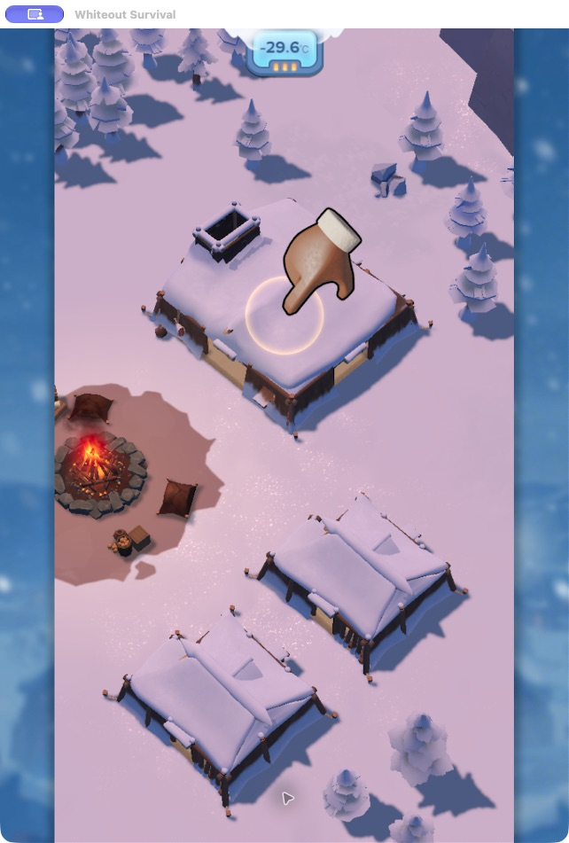
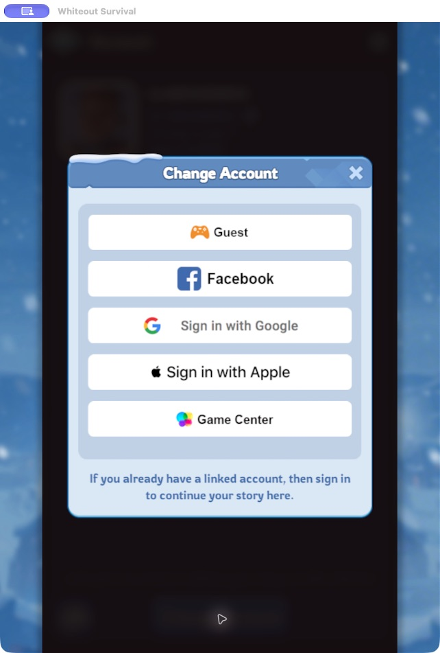

[English](README.md) · [简体中文](README.zh-CN.md) · [日本語](README.ja.md)

---

## From the tutorial to sign-in

<table>
<tr><th>01 · Follow the required tutorial prompts</th><th>02 · Choose your existing account</th></tr>
<tr><td align="center"></td><td align="center"></td></tr>
</table>

<sub>Actual game screens. The skill stops at sign-in; you complete the login.</sub>


## Get back to your account

You install Whiteout Survival on a new device, ready to return to your city—and find yourself chopping wood in the opening tutorial again.

Questnori helps you through the required steps, skips the story scenes, and opens **Change Account**. You choose the sign-in method linked to your existing account from there.

### Take the shorter route

You don't need to finish Chapter 1 on the version documented here. Once the opening cooking tutorial and first fire reward are complete, the profile menu becomes available:

**Profile → Settings → Account → Change Account**

Already have access to your profile? Go straight to Settings. For the opening steps, see the [walkthrough](skills/whiteout-login-fast/references/route.md) (Chinese).

## Let Questnori handle the tutorial

The **Quick Sign-in** skill runs through Codex's computer-use tools. It reads the current screen, follows the tutorial prompts, and stops when the sign-in options appear. Screenshots and action logs stay on your computer.

| What it does | What you handle |
| --- | --- |
| Skips story scenes and completes required tutorial actions | Choose your existing account's sign-in method |
| Opens the account menu | Complete sign-in |
| Records the steps for later reference | Keep control of your account |

### Get started

**You'll need:** the game running on macOS and a Codex environment with computer-use tools (`cua_repl`).

1. Download or clone this repository.
2. Copy `skills/whiteout-login-fast` into `~/.codex/skills/`.
3. Open the game and ask Codex:

```text
Use $whiteout-login-fast to get past the opening tutorial
and stop at the account sign-in screen.
```

[Read the skill](skills/whiteout-login-fast/SKILL.md) · [View the recording script](skills/whiteout-login-fast/scripts/tutorial-session.mjs)

## A few things to know

This is a desktop skill, not a standalone phone app. The current flow has been checked on macOS; Android and iPhone automation are not supported by this release. Game updates may change the tutorial or menu layout.

The skill uses ordinary tutorial resources, avoids purchases and diamond spending, and stops before account sign-in. It does not recover passwords or link accounts. Detailed instructions and the walkthrough are currently in Chinese; this project overview is available in three languages.

---

**Questnori** builds practical AI player tools, one game at a time. This repository is home to its Whiteout Survival skills.

An independent project, not affiliated with the game's publisher.
