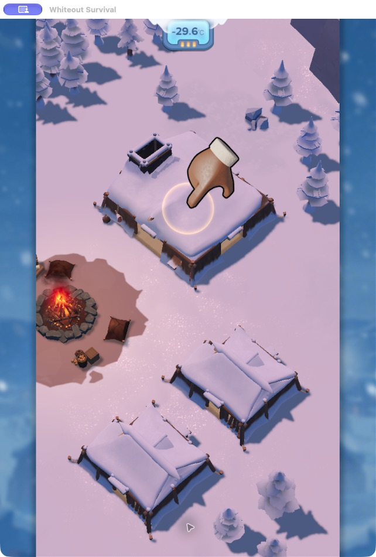
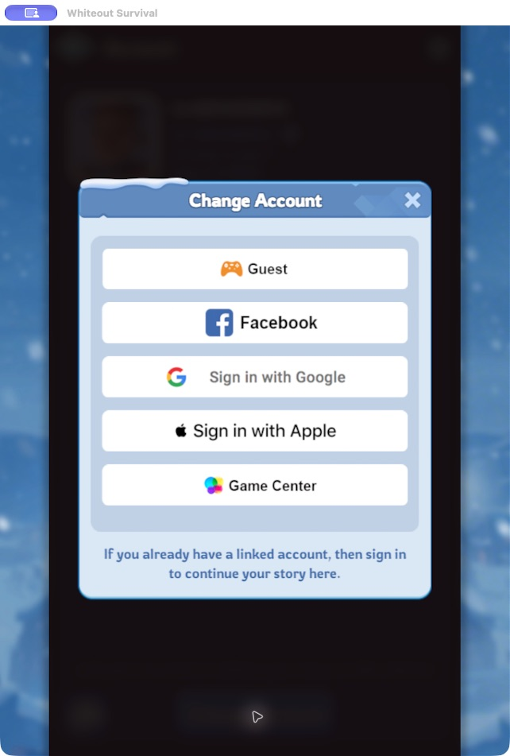

[English](README.md) · [简体中文](README.zh-CN.md) · [日本語](README.ja.md)

---

## 从新手引导，到账号登录

<table>
<tr><th>01 · 完成必要的新手操作</th><th>02 · 选择原账号的登录方式</th></tr>
<tr><td align="center"></td><td align="center"></td></tr>
</table>

<sub>真实游戏画面。技能在登录入口停止，后续登录由你完成。</sub>


## 只是想登录，却又开始砍树了？

新设备装好游戏，本想回到自己的城镇，迎面而来的却是开场剧情、伐木和生火。

游诺帮你走完必要的引导、跳过剧情，打开**切换账号（Change Account）**。接下来，选择原账号绑定的登录方式，就可以继续登录。

### 不必一路做完第一章

在这里记录的游戏版本中，完成开场厨房引导、领取首次点火奖励后，就能使用头像菜单：

**头像 → 设置（Settings）→ 账号（Account）→ 切换账号（Change Account）**

如果头像已经可以点击，直接进入设置即可。还停在开场引导的话，可以查看[完整路线](skills/whiteout-login-fast/references/route.md)。

## 把这段引导交给游诺

**快速登录技能（Quick Sign-in）**通过 Codex 的电脑操作工具读取当前画面、跟随引导提示，直到登录方式出现。操作截图和日志保存在你的电脑上，方便以后查阅。

| 游诺来做 | 你来完成 |
| --- | --- |
| 跳过剧情，完成必要的新手操作 | 选择原账号的登录方式 |
| 打开账号菜单 | 完成登录 |
| 留下操作记录 | 保管自己的账号 |

### 开始使用

**准备条件：**在 macOS 上运行游戏，并使用支持电脑操作工具（cua_repl）的 Codex 环境。

1. 下载或克隆这个仓库。
2. 将 `skills/whiteout-login-fast` 复制到 `~/.codex/skills/`。
3. 打开游戏，对 Codex 说：

```text
使用 $whiteout-login-fast 帮我走过开场新手引导，
到账号登录界面就停下。
```

[查看技能说明](skills/whiteout-login-fast/SKILL.md) · [查看操作记录脚本](skills/whiteout-login-fast/scripts/tutorial-session.mjs)

## 使用前了解一下

这是桌面端技能，不是可以独立运行的手机应用。目前流程适用于已验证的 macOS 游戏环境，暂不支持 Android 或 iPhone 自动操作；游戏更新后，引导和菜单位置可能变化。

技能只使用新手流程中的普通资源，不充值、不消费钻石，在账号登录前停止。密码找回和账号绑定仍需自行处理。项目首页提供三种语言，详细技能说明与路线文档目前为中文。

---

**游诺（Questnori）**从一个个具体游戏场景出发，制作实用的 AI 玩家工具。这里收录无尽冬日相关技能。

本项目独立开发，与游戏发行方无隶属关系。
